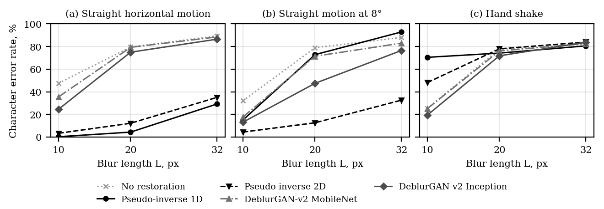

# deblur-vs-filter

Code for the paper "Efficiency of blurred image restoration: classical pseudo-inverse filtering
versus the generative network DeblurGAN" (A. Marinenko, S. Vovk, Oles Honchar Dnipro National University, MEICS-2026).

When the camera moves during exposure, letters get smeared and OCR stops working. Today such images
are usually restored with networks like DeblurGAN-v2, but papers rarely say how much time and energy
each call costs. A pseudo-inverse filter needs only two FFTs. We check for which kinds of motion a fully
automatic filter (blur length and angle found from the cepstrum) still reads text better than the network,
and at what cost.

## How to run

You need Tesseract (`apt install tesseract-ocr`) and a GPU for the networks (they also run on CPU, just slowly).

```bash
pip install -r requirements.txt

# DeblurGAN-v2: authors' code and weights (no training)
git clone https://github.com/VITA-Group/DeblurGANv2
mkdir weights
gdown 1JhnT4BBeKBBSLqTo6UsJ13HeBXevarrU -O weights/fpn_mobilenet.h5
gdown 1UXcsRVW-6KF23_TNzxw-xC0SzaMfXOaR -O weights/fpn_inception.h5

# 1. 35 sharp text images (5 validation + 30 test), each blurred under 48 conditions
python scripts/01_make_dataset.py --out data --n-test 30 --n-val 5 --corpus texts/holmes_scenes.txt

# 2. alpha^2 on validation, 6 methods on 1440 test images, OCR, time and energy
python scripts/02_run_experiment.py --data data --out results --energy-seconds 30

# 3-4. extra figures, summary table, statistics per text
python scripts/04_stats.py --synthetic results
python scripts/03_make_figures.py --data data --res results

# 5. atlas (input -> output for every condition) and Fig. 2
python scripts/05_atlas.py --data data --out atlas_out --ids test_000,test_001

# 6-8. Fig. 1, cepstrum figure, all numbers used in the paper
python scripts/06_fig_cer_vs_length.py --res results --lang en --out results/paper_fig1_en.jpg
python scripts/07_fig_cepstrum.py --atlas atlas_out --id test_000 --lang en --out results/fig_cepstrum_en.jpg
python scripts/08_paper_numbers.py --res results > results/paper_numbers.txt
```

The same steps are in `notebooks/deblur_vs_filter_kaggle.ipynb`. The results below were obtained on Kaggle
(Intel Xeon 2.0 GHz, Tesla T4), a full run takes about 1 hour.
The images are made with a fixed seed (2026) and fixed fonts, so the texts are the same on every run
(md5 of `data/gt_text.json` is `3cdc024f2f7341fd61d69f950ce01d22`). Time and energy change a little from run to run.

## Methods

| name in the results | in the paper | what it does |
|---|---|---|
| `blurred` | No restoration | the blurred image as it is |
| `pinv_oracle` | – | 1D filter with the true blur length (only for checking) |
| `pinv_blind` | Pseudo-inverse 1D | L from the 1D cepstrum, W = H*/(\|H\|² + α²), H = sinc |
| `pinv2d_blind` | Pseudo-inverse 2D | L and angle from the 2D cepstrum, H = FFT of a line, mirror padding |
| `dgv2_mobilenet` | DeblurGAN-v2 MobileNet | authors' weights, 3.3 M parameters |
| `dgv2_inception` | DeblurGAN-v2 Inception | authors' weights, 61 M parameters |

α² is never tuned on test images: it is picked per noise level on the validation images,
and on a test image the noise level is estimated automatically.

## Results

CER of Tesseract, % (lower is better), mean over 30 texts, 3 lengths and 4 noise levels, and cost per image:

| Method | Horizontal | At 8° | Shake | CPU, ms | GPU, ms | Energy, J (CPU / GPU) |
|---|---|---|---|---|---|---|
| No restoration | 72.2 | 66.3 | 61.7 | – | – | – |
| Pseudo-inverse 1D | 11.3 | 60.3 | 75.0 | 12 | – | 0.8 |
| Pseudo-inverse 2D | 16.8 | 16.5 | 70.0 | 30 | – | 2.0 |
| DeblurGAN-v2 MobileNet | 67.7 | 57.4 | 61.3 | 187 | 15 | 12.3 / 1.3 |
| DeblurGAN-v2 Inception | 62.0 | 45.7 | 58.3 | 611 | 46 | 39.5 / 4.3 |

For straight motion the filter wins on every one of the 30 texts (Wilcoxon test over texts, p < 0.001)
and is much cheaper. For hand shake the path is curved, the cepstrum has no single peak, and only the
heavy network helps a bit.



All numbers are in `results/paper_numbers.txt`, per text statistics in `results/stats_paired.csv`
and `results/stats_ci.csv`, the full per image results in `results/quality.csv`.
Fig. 2 of the paper is `atlas_out/fig_examples_en.png`.

## Files

```
deblur/degradation.py    blur models: sinc (formula 1), box, line at 8°, hand shake + gamma + JPEG
deblur/textgen.py        text images with known ground truth
deblur/classical.py      1D pseudo-inverse filter, blur length from the cepstrum
deblur/classical2d.py    2D filter, length and angle from the 2D cepstrum
deblur/deblurgan.py      wrapper for the official DeblurGAN-v2 code
deblur/metrics.py        CER, WER, PSNR, SSIM, Tesseract
deblur/energy.py         time and energy (CodeCarbon)
scripts/01-08            the steps above
texts/holmes_scenes.txt  passages from "The Adventures of Sherlock Holmes" (public domain)
```

## Citation

If you use this code, please cite:

> A. Marinenko, S. Vovk. Efficiency of blurred image restoration: classical pseudo-inverse filtering
> versus the generative network DeblurGAN. MEICS-2026.

## Notes

- The blur is simulated, not real photos. The hand shake model only roughly imitates a phone camera.
- Energy is for the whole machine (CodeCarbon), so it is almost proportional to time.
- DeblurGAN-v2: https://github.com/VITA-Group/DeblurGANv2 (Kupyn et al., ICCV 2019).

## License

MIT, see `LICENSE`.
